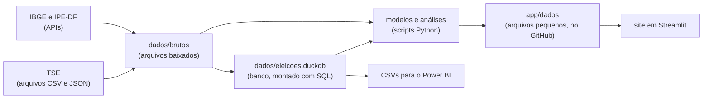

# Parte 1: visão geral

## O que o projeto faz, em uma frase

Baixa os dados oficiais das eleições (TSE) e de população (IBGE), organiza
tudo num banco de dados, roda análises e modelos estatísticos e mostra os
resultados num site, sempre conferindo se as somas batem com o oficial.

## O caminho dos dados

Quatro ideias explicam quase tudo:

1. **Baixar, transformar e mostrar ficam separados.** Um script baixa, outro
   transforma, o site só mostra. Se o site quebrar, os dados continuam certos; se
   o TSE mudar um arquivo, só o script daquele arquivo muda.
2. **O site só lê arquivos pequenos.** Os dados brutos passam de 3 GB; o que o site
   usa (`app/dados/`) tem poucos MB. É isso que deixa o site rápido e cabendo no
   plano grátis do Streamlit Cloud.
3. **Tudo pode ser refeito com um comando** (`scripts/rodar_tudo.py`). Qualquer
   pessoa clona o repositório e chega aos mesmos números.
4. **Toda soma é conferida com o oficial.** Antes de qualquer análise, o código
   confere se a soma dos municípios (ou das seções, ou dos boletins de urna) é igual
   ao total divulgado pelo TSE. Se não for, o script avisa ou para.

## As pastas

| Pasta | O que tem | Exemplo |
|---|---|---|
| [`eleicoes/`](../../eleicoes) | a **biblioteca**: código reutilizável, sem efeitos colaterais (não baixa nada sozinho, não grava arquivo) | `modelo_2t.py` (o modelo), `tse_ao_vivo.py` (o cliente do TSE) |
| [`scripts/`](../../scripts) | os **programas**: cada um faz uma etapa e grava o resultado | `montar_base.py`, `site_dinheiro.py` |
| [`sql/`](../../sql) | as **transformações em SQL** que montam o banco, e as **checagens** | `01_votos_presidente.sql`, `checagens/03_comparecimento_fecha.sql` |
| [`app/`](../../app) | o **site** (Streamlit) e os arquivos pequenos que ele lê | `site.py`, `paginas/`, `dados/` |
| [`tests/`](../../tests) | os **testes automáticos** (pytest) | `test_acompanhamento.py` |
| [`docs/`](..) | a documentação e as imagens | `previsao.md`, este guia |
| [`powerbi/`](../../powerbi) | o tema e as tabelas para o Power BI | `tema_neutro.json` |
| `dados/` | tudo o que é baixado ou calculado. **Não vai para o GitHub** (grande demais), com uma exceção: a gravação da noite de 25/10 | `dados/brutos/`, `dados/eleicoes.duckdb` |

**Por que assim?** Separar `eleicoes/` (funções) de `scripts/` (programas) é o
que permite testar. Uma função como `projetar()` recebe uma tabela e devolve um
resultado: dá para testá-la com uma tabela inventada de 3 municípios. Um script
que baixa da internet e grava em disco é muito mais difícil de testar.

## As ferramentas, e por que cada uma

| Ferramenta | Para quê | Por que ela |
|---|---|---|
| **Python** | tudo | a linguagem mais usada em dados; tem biblioteca para cada etapa |
| **pandas** | tabelas na memória | o padrão para manipular tabelas em Python |
| **NumPy** | contas com vetores e matrizes | as simulações fazem milhões de contas; em NumPy elas rodam de uma vez, sem laço |
| **DuckDB** | banco de dados e SQL | lê CSV e Parquet direto, sem instalar servidor, e é muito rápido em tabelas grandes. Um arquivo `.duckdb` é o banco inteiro |
| **Parquet** | formato dos arquivos intermediários | colunar e comprimido: um CSV de 1 GB vira dezenas de MB, e os tipos (número, texto, data) ficam guardados |
| **SQL** | juntar e resumir tabelas | para "junte votos com comparecimento por município e ano", SQL é mais claro que pandas |
| **requests** | baixar da internet | simples e com controle de cabeçalhos (precisamos do `Range`, veja a parte 2) |
| **SciPy** | um ajuste com restrições | a inferência ecológica (parte 3) precisa de "mínimos quadrados com limites" |
| **Shapely** | geometria | dizer em qual região administrativa do DF cai cada local de votação |
| **Streamlit** | o site | site de dados em Python puro, sem HTML/JavaScript, e com hospedagem grátis |
| **Plotly** | gráficos e mapas interativos | funciona no Streamlit, com mapa por município e passar o mouse |
| **Matplotlib** | imagens fixas (PNG) | os gráficos da documentação e do README |
| **pytest** | testes | o padrão em Python |
| **Playwright** | fotos do site | abre o site num navegador sem janela e fotografa cada página, para conferir o visual |
| **Git e GitHub** | histórico e publicação | cada mudança fica registrada; o site se atualiza quando a `main` muda |

## Como ler o código

Comece por cima e desça:

1. [`README.md`](../../README.md): o que o projeto entrega.
2. [`scripts/rodar_tudo.py`](../../scripts/rodar_tudo.py): a lista de etapas, em
   ordem, com uma frase sobre cada uma. É o índice do projeto.
3. Escolha uma etapa e abra o script. Todo script começa com um texto (docstring)
   explicando o que faz, de onde vêm os dados e o que grava.
4. Quando o script chamar uma função de `eleicoes/`, abra a biblioteca.

## Vocabulário

| Termo | O que é |
|---|---|
| **Seção** | a menor unidade da votação: uma urna, com uns 300 eleitores |
| **Zona eleitoral** | um conjunto de seções, administrado por um cartório eleitoral |
| **Código TSE × código IBGE** | o TSE numera os municípios de um jeito (ex.: `71072` = São Paulo) e o IBGE de outro (`3550308`). O mapa usa o do IBGE; os resultados vêm com o do TSE. O projeto guarda os dois |
| **Votos válidos** | votos dados a algum candidato (sem brancos e nulos). As porcentagens oficiais usam votos válidos |
| **Ponto percentual** | diferença entre duas porcentagens: de 48% para 50% são **2 pontos** (e não 2%) |
| **Logit** | uma transformação da porcentagem usada nos modelos: `log(p / (1 − p))`. Explicada na parte 3 |
| **BU (boletim de urna)** | o resultado impresso e transmitido por cada urna |
| **RDV (registro digital do voto)** | a lista de todos os votos de uma urna, embaralhados, sem identificar o eleitor |
| **FEFC (fundo eleitoral)** | dinheiro público dividido entre os partidos para as campanhas |

## Para praticar

Abra [`scripts/rodar_tudo.py`](../../scripts/rodar_tudo.py) e responda:
- Quais etapas fazem parte do modo "essencial"? Quais ficam só no `--completo`, e
  por quê (dica: olhe o tempo e o tamanho do download)?
- Em que ordem o banco é montado e o modelo é rodado? Por que essa ordem é obrigatória?

## Na entrevista

> "É um pipeline de dados de ponta a ponta. Python baixa os dados do TSE e do IBGE,
> DuckDB e SQL organizam num banco, modelos estatísticos em Python preveem o 2º
> turno, e um site em Streamlit mostra tudo. Cada etapa confere as somas com o
> resultado oficial. E tudo é reprodutível: um comando refaz o projeto inteiro."
