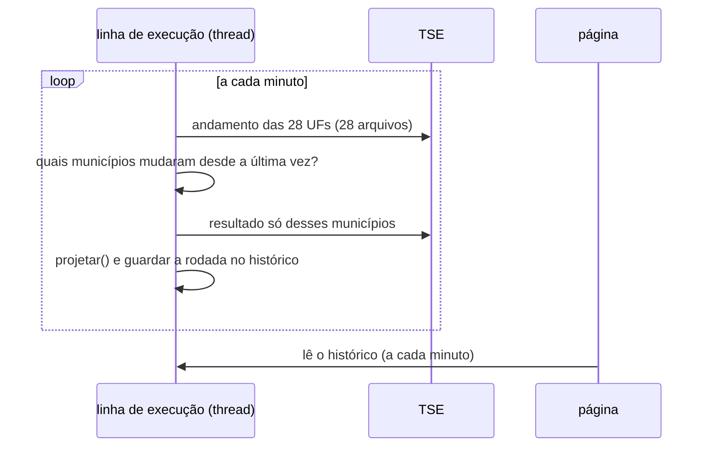

# Parte 4: apuração ao vivo

Arquivos: [`eleicoes/ao_vivo.py`](../../eleicoes/ao_vivo.py) (a projeção),
[`eleicoes/acompanhamento.py`](../../eleicoes/acompanhamento.py) (o motor que
roda dentro do site), [`app/paginas/apuracao.py`](../../app/paginas/apuracao.py)
(a página) e, para a noite de 25/10,
[`scripts/gravar_noite.py`](../../scripts/gravar_noite.py),
[`scripts/analisar_noite.py`](../../scripts/analisar_noite.py) e
[`scripts/reproduzir_noite_2026.py`](../../scripts/reproduzir_noite_2026.py).

## O problema

O placar parcial engana. As regiões apuram em ritmos diferentes: no 2º turno de
2022, com metade das seções apuradas, o placar mostrava um candidato à frente, e o
outro venceu. A liderança só virou com 68% apurado. A projeção tenta responder,
a cada minuto: **juntando o que já foi apurado com o que ainda falta, onde isso
deve terminar?**

## A ideia em quatro passos

Antes da eleição, o modelo da parte 3 deu uma previsão para cada município (o
*prior*). Durante a apuração ([`projetar`](../../eleicoes/ao_vivo.py)):

1. **Comparar o que chegou com o que era esperado.** Em cada município com votos,
   o **resíduo** é o resultado parcial menos a previsão, em logit.
2. **Descobrir o padrão do erro.** Se a previsão está errando 1 ponto para o mesmo
   lado em vários municípios de uma UF, provavelmente erra também nos que ainda
   não apuraram. O modelo estima três tipos de erro: um do **país inteiro**, um
   que depende do **tamanho do município** e um de **cada UF**.
3. **Projetar os votos que faltam.** Para cada município: eleitores que faltam ×
   votos válidos esperados por eleitor × % esperado de A (a previsão corrigida
   pelo erro estimado).
4. **Sortear milhares de cenários** dos erros, para ter intervalo e probabilidade.

## Passo 2 em detalhe: um modelo bayesiano com fórmula fechada

O resíduo de cada município é modelado como

```
resíduo_i = erro_país + inclinação × tamanho_i + erro_UF(i) + ruído_i
```

Em matriz: `r = X · efeitos + ruído`. `X` tem uma coluna de 1 (o erro do país),
uma com o tamanho (log do eleitorado) e uma coluna por UF, com 1 nos municípios
daquela UF ("one-hot"):

```python
X = np.column_stack([np.ones(len(estado)), tamanho, np.eye(n_uf)[uf_idx]])
```

Antes de ver qualquer voto, cada efeito tem uma "faixa esperada" (o *prior*): o
erro do país costuma ficar em ±0,17 em logit, o de cada UF em ±0,125. Com prior
normal e ruído normal, a resposta tem **fórmula fechada**, sem simulação nem
iteração ([`_posterior_erros`](../../eleicoes/ao_vivo.py)):

```python
precisao = np.diag(precisao_prior)              # o que se sabia antes (1 / variância)
precisao += X.T @ (X * inv[:, None])            # + o que os dados ensinam
vetor = X.T @ (inv * r)
cov = np.linalg.inv(precisao)
media = cov @ vetor                             # a melhor estimativa dos efeitos
```

É a mesma conta de uma regressão linear, com dois acréscimos: o prior funciona
como "puxar para zero quando há poucos dados" (com 3 municípios apurados, o
modelo não acredita num erro de 5 pontos), e o resultado vem com a covariância (a
incerteza de cada efeito e como eles se relacionam).

**Quanto confiar em cada município?** O ruído de cada um tem variância

```python
var_obs = sigma_mun**2 + c_tamanho / votos + sigma_parcial**2 * (1 - fracao_apurada)
```

Município pequeno (poucos votos) pesa menos. Município com pouco apurado também,
porque as primeiras seções de um município podem não representar o resto. Essa
última parte, como você vai ver, foi o ponto fraco na noite de 2026.

## Passo 3: os votos que faltam

```python
taxa = np.where(fracao >= 0.2, taxa_obs, estado["taxa_validos"])
restante = (aptos - aptos_apurados) * taxa
```

Quantos votos válidos ainda vão sair de cada município? Com pelo menos 20%
apurado, usa a taxa observada ali (votos válidos ÷ eleitores apurados); antes
disso, a do 1º turno.

## Passo 4: os sorteios

Em cada cenário:

1. sorteia os efeitos (país, tamanho, UFs) da distribuição estimada no passo 2,
   com `multivariate_normal(media, cov)`;
2. em cada município já iniciado, parte do desvio observado ali continua no que
   falta (o peso `rho`);
3. soma o **"atraso"**: um erro comum a tudo o que falta apurar, no país e por UF.
   Ele existe porque o que chega por último pode ser sistematicamente diferente do
   que chegou antes, e esse erro não diminui com mais dados;
4. o % de A no país = (votos de A já apurados + votos esperados de A no que falta)
   ÷ total.

Com 3.000 cenários: mediana, intervalo de 90% e chance de vencer. A projeção só é
publicada a partir de 5% apurado (`MINIMO_APURADO`): antes disso, oscila demais.

## O motor dentro do site

O site não depende de nenhum computador ligado: o próprio processo do Streamlit
coleta e projeta ([`Acompanhamento`](../../eleicoes/acompanhamento.py)).



Detalhes que importam:

- **Uma linha de execução (thread) em segundo plano**, criada uma vez só. Na página,
  `@st.cache_resource` garante **um único motor por processo**: 1 ou 1.000
  pessoas com a página aberta, o TSE recebe os mesmos poucos pedidos por minuto.
- **Só baixa o que mudou.** Cada município tem uma "versão" (seções totalizadas,
  hora da totalização). Se a versão não mudou, não baixa de novo. São milhares de
  downloads a menos por minuto.
- **Uma falha não derruba a rodada** (`_seguro`): se o TSE recusa um arquivo, ele
  fica para a rodada seguinte. Ver o caso do 429 abaixo.
- **O eleitorado apurado só avança junto com os votos.** Se o download de um
  município falhar, ele não conta como apurado. Senão a projeção acharia que um
  município está apurado com zero votos.
- **Trava (`threading.Lock`)** ao mexer no histórico, porque a página lê enquanto
  a linha de execução escreve.

## A noite de 25/10: o que deu errado e como foi resolvido

**1. A votação foi prorrogada até as 19h** e o TSE parou a divulgação das 17h06 às
19h01. O motor não precisou de mudança: ele só via "nada novo".

**2. O TSE começou a recusar pedidos (HTTP 429, "pedidos demais")** por volta das
19h30. O gravador da noite passou a pedir menos: 2 downloads em paralelo em vez de
6, sem repetir na hora, no máximo N municípios por rodada (os que mais avançaram
primeiro) e espera em dobro depois de muitas recusas.

**3. Um bug que os testes não pegavam:** o cache do TSE às vezes entregava o
arquivo de um município *mais velho* que o andamento: o andamento dizia "2 seções
apuradas" e o arquivo de votos ainda tinha zero. O motor registrava o município
como apurado com zero votos e só o baixava de novo na próxima mudança. A correção,
em `_votos`:

```python
if r.resumo.get("qt_secoes_totalizadas", secoes) < secoes:
    # o cache do TSE às vezes entrega o arquivo do município mais velho que o andamento
    return None      # não vale como apurado; é pedido de novo na próxima rodada
```

E um teste novo que simula exatamente isso.

**4. O processo do gravador morria** quando a sessão ficava parada. Ele passou a
salvar o estado a cada rodada e a continuar de onde parou ao ser reiniciado.

## Depois da noite: separar o erro do modelo do erro da coleta

A projeção começou errando ~3 pontos. Foi o modelo ou a coleta?
[`reproduzir_noite_2026.py`](../../scripts/reproduzir_noite_2026.py) refaz a noite
com arquivos que o TSE publicou depois da eleição.

**O histórico de totalização** diz, para cada zona, quando e quanto foi somado.
Para saber "o que o TSE tinha divulgado às 19h32 em cada município", é preciso,
para cada zona, o **último registro antes de 19h32**. Isso é um *ASOF join*, que o
DuckDB faz direto:

```sql
from grade g
asof left join eventos e
  on g.uf = e.uf and g.cd_municipio_tse = e.cd_municipio_tse and g.zona = e.zona
 and g.momento >= e.momento
```

(`asof` = "o registro mais recente de `e` cujo momento seja ≤ o de `g`".)

Com isso, três versões da noite:

| Apurado | Ao vivo | Coleta perfeita | Votos na ordem do 1º turno |
|---|---|---|---|
| 5% | −3,0 | −2,9 | −0,4 |
| 10% | −2,6 | −1,2 | +0,2 |
| 25% | +0,1 | 0,0 | +0,7 |

Conclusões:

- **A coleta pesou perto dos 10%**, mas o erro do começo existiria mesmo com coleta
  perfeita: **foi do modelo**.
- **A causa:** a primeira seção contada em cada município foi, em média, 0,8 ponto
  menos favorável a um candidato do que o resultado final do próprio município (na
  ordem do 1º turno, 0,3). O modelo trata as primeiras seções como amostra sem viés
  e dá quase o mesmo peso a cada município. Com 1.802 municípios mostrando uma ou
  poucas seções inclinadas para o mesmo lado, ele leu isso como uma mudança no país
  inteiro.
- **A prorrogação em si mexeu pouco:** 98,5% das urnas fecharam até 17h30 (os
  boletins trazem a hora local, convertida para Brasília pelo fuso de cada
  município).
- **O ajuste a fazer:** um termo de erro **comum** às apurações parciais (hoje o
  ruído de cada município é independente, então se cancela com muitos municípios,
  e um viés comum não se cancela).

**Por que essa análise é importante?** Porque é o que se faz em trabalho de
verdade: quando algo dá errado, você não chuta a causa. Você monta um experimento
que separa as hipóteses (modelo × coleta × ordem de chegada) e mede cada uma.

## Para praticar

1. Em [`tests/test_ao_vivo.py`](../../tests/test_ao_vivo.py), a projeção é testada
   com municípios inventados (`municipios()` e `apurar()`). Leia os três testes.
   Depois escreva um quarto que **reproduz o problema de 2026**: uma função
   `apurar_com_vies(df, fracao)` em que as seções apuradas de cada município dão a A
   um pouco menos que o resultado real do município (ex.: −0,05 em logit). Com 5%
   apurado, a projeção erra para o mesmo lado? Esse teste é o ponto de partida do
   ajuste que ficou no roteiro.
2. Mude `sigma_parcial` de 0,20 para 0,40 em `Parametros` e rode
   `scripts/reproduzir_noite_2026.py` (precisa dos dados baixados). O erro do
   começo diminui? E o intervalo, fica mais largo?

## Na entrevista

> "A projeção compara o que já foi apurado com a previsão de antes e estima, com um
> modelo bayesiano, se o erro é do país, da UF ou do tamanho do município. Aí
> projeta o que falta e simula milhares de cenários. Roda dentro do site, numa
> thread, baixando só os municípios que mudaram. Na noite de verdade ela ficou do
> lado de quem venceu o tempo todo, mas começou errando 3 pontos. Depois, com os
> dados oficiais, refiz a noite e descobri que o erro era do modelo: as primeiras
> seções de cada município puxavam para o mesmo lado, e o modelo tratava isso como
> ruído independente."
