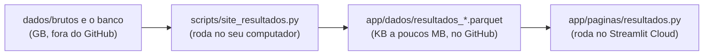

# Parte 5: o site

Arquivos: [`app/site.py`](../../app/site.py) (a entrada),
[`app/comum.py`](../../app/comum.py) (o que todas as páginas usam),
[`app/paginas/`](../../app/paginas) (uma página por arquivo) e os scripts
`scripts/site_*.py`, que preparam os dados de cada página.

## 1. Como o Streamlit funciona (o que surpreende no começo)

**Cada interação roda o arquivo da página inteiro de novo, de cima a baixo.**
Mudou um filtro? O Streamlit executa o arquivo de novo, e o valor novo do filtro
aparece na variável. Não existe "quando clicar, faça isso": o código é uma
receita que desenha a página com o estado atual.

```python
uf = st.selectbox("Mostrar no mapa", opcoes)      # na 1ª vez, "Brasil"; depois, o que a pessoa escolheu
d = municipios if uf == "Brasil" else municipios[municipios["uf"] == uf]
st.plotly_chart(mapa(d))
```

Isso é simples, mas tem um custo: se cada execução lesse um arquivo de 50 MB, o
site ficaria lento. Por isso existem os **caches**:

| Cache | Guarda | Usado para |
|---|---|---|
| `@st.cache_data` | o **resultado** de uma função (uma cópia para cada chamada) | ler um Parquet (`comum.ler`), montar uma tabela formatada |
| `@st.cache_resource` | um **objeto único**, compartilhado por todas as pessoas | o motor da apuração ao vivo (uma thread só); a malha do mapa |

E dois recursos usados na apuração ao vivo:

- `@st.fragment(run_every=60)`: só aquele pedaço da página se redesenha a cada 60
  segundos, sem rodar a página inteira de novo.
- `st.rerun()`: força a página inteira a rodar de novo. Usado para trocar do modo
  "antes da apuração" para o modo "ao vivo" na hora certa, sem a pessoa recarregar.

## 2. A estrutura

[`app/site.py`](../../app/site.py) só monta o menu:

```python
paginas = {
    "Resultados": [
        st.Page("paginas/resultados.py", title="Resultados e mapa", icon=":material/map:", url_path="resultados"),
        ...
    ],
    ...
}
st.navigation(paginas, expanded=True).run()
```

Cada página é um arquivo comum em `app/paginas/`. O `url_path` é o fim do
endereço (`.../resultados`).

## 3. A regra mais importante: o site só lê arquivos pequenos



Cada página tem um script `site_*.py` que faz todo o trabalho pesado (baixar,
juntar, calcular) e grava só o que a página precisa mostrar. A página só lê e
desenha.

**Por que assim?** O Streamlit Cloud grátis tem pouca memória e o site "dorme"
quando ninguém usa. Se cada visita tivesse de baixar e calcular, a primeira
abertura levaria minutos. Assim, abre em segundos. Os arquivos de `app/dados/` vão
para o GitHub, e o site publicado usa exatamente esses.

## 4. `comum.py`: o que todas as páginas compartilham

[`app/comum.py`](../../app/comum.py) existe para cada página não reinventar a mesma
coisa (e para todas ficarem iguais):

- **Ler os dados:** `ler("resultados_placar")` lê `app/dados/resultados_placar.parquet`,
  com cache; `existe(nome)` diz se o arquivo existe (útil para seções que só
  aparecem depois de um evento, como o 2º turno).
- **Formatar em português:** `numero(1234567)` → "1.234.567"; `pct(0.4821)` →
  "48,2%"; `pontos(0.017)` → "1,7 ponto" (singular até 1, plural depois).
- **Cores neutras:** `VIOLETA` e `VERDE_AGUA` para os dois candidatos (o 1º em
  ordem alfabética é sempre violeta); `cores_finalistas(nomes)` faz essa regra
  valer em todo lugar. Nenhuma cor lembra partido.
- **Visual dos gráficos:** `estilo(fig)` aplica fundo, grade, fonte, vírgula
  decimal (`separators=",."`) e `automargin` (sem ele, rótulos longos são cortados).
- **`mostrar(fig, tabela, fonte)`:** desenha o gráfico, a fonte embaixo e, num
  quadro que abre e fecha, **a tabela com os mesmos números**. É acessibilidade:
  quem não enxerga bem as cores, ou quer o número exato, lê a tabela.
- **`cartao`, `cabecalho`, `rodape`:** os blocos visuais repetidos.

## 5. Anatomia de uma página: a inicial

[`app/paginas/inicio.py`](../../app/paginas/inicio.py) mostra um padrão usado no
site todo: **nenhum número escrito à mão**. O cartão "214 municípios mudaram de
lado" é calculado do arquivo:

```python
viraram = no_mapa[no_mapa["mudou_desde_o_1t"] & no_mapa["mais_votado"].isin([A, B])]
achados.append(("paginas/resultados.py", ":material/map:", "Resultados e mapa",
                f"{comum.numero(len(viraram))} municípios", "mudaram de quem ficou à frente..."))
```

Se o TSE atualizar um dado e o script rodar de novo, o texto se corrige sozinho.
Texto escrito à mão fica velho e ninguém percebe.

Cada achado só aparece se o arquivo existir (`if comum.existe(...)`). Assim, a
página funciona antes e depois da eleição, e não quebra se uma etapa ainda não
rodou.

## 6. Mapas

O mapa de municípios ([`resultados.py`](../../app/paginas/resultados.py)) é um
`go.Choropleth` do Plotly: cada município é um polígono pintado pela vantagem de
quem ficou à frente. Três problemas resolvidos:

**O arquivo de contornos era grande demais.** A malha do IBGE tem detalhe de
metros. [`site_resultados.py`](../../scripts/site_resultados.py) simplifica com o
**algoritmo de Douglas-Peucker**: tira os pontos que quase não mudam o desenho.
Mas simplificar cada município sozinho abre frestas entre vizinhos (cada um
simplifica a divisa de um jeito). A solução: separar as divisas em trechos entre
"nós" e simplificar **cada trecho uma vez**, usando o mesmo resultado para os dois
lados (`simplificar_malha`).

**Polígonos "do avesso".** O Plotly (que usa a biblioteca d3) espera o contorno
externo no sentido horário. No sentido contrário, ele entende "o planeta inteiro
menos o município" e pinta tudo. `orientar()` mede o sentido de cada anel com a
**fórmula do cadarço** (área com sinal) e inverte quando precisa.

**Mapas em branco no site publicado.** Os mapas do Plotly baixam um contorno do
mundo de `cdn.plot.ly`. Uma tentativa de servir esse arquivo pelo próprio site
deixou os mapas em branco no Streamlit Cloud. A correção foi voltar ao endereço
padrão. Ficou um comentário no código para ninguém repetir o erro.

O mapa do DF usa outra ideia: pontos (`go.Scattergeo`) para os locais de votação
e os contornos das 35 regiões administrativas (parte 6).

## 7. Publicação

- **Onde:** Streamlit Community Cloud (grátis), ligado ao repositório. Toda vez que
  a `main` muda, o site se atualiza em 1 ou 2 minutos.
- **Bibliotecas:** [`app/requirements.txt`](../../app/requirements.txt) tem só o que
  o site usa (menos coisa instalada = site sobe mais rápido).
- **Aparência:** [`.streamlit/config.toml`](../../.streamlit/config.toml) (tema
  claro, cor de destaque cinza, para nada na interface lembrar partido).
- O passo a passo está em [`docs/publicar_site.md`](../publicar_site.md).

## 8. Conferir o site sem abrir o navegador

- **Teste automático de cada página** ([`tests/test_site.py`](../../tests/test_site.py)):
  o `AppTest` do Streamlit roda cada página sem navegador e falha se alguma der
  erro. Pega, por exemplo, uma coluna que mudou de nome num arquivo de dados.
- **Fotos** ([`scripts/ver_site.py`](../../scripts/ver_site.py)): o Playwright abre o
  site num navegador sem janela e tira uma foto de cada página. Serve para ver
  problemas visuais (rótulo cortado, texto sobreposto) que um teste não pega.

## Para praticar

1. Rode o site no seu computador (`.venv\Scripts\python -m streamlit run app/site.py`).
   Mude a cor `VIOLETA` em `comum.py` e veja o site inteiro mudar.
2. Na página inicial, adicione um achado novo: "X% de abstenção no 2º turno",
   calculado de `resultados_2t` (comparecimento ÷ aptos). Rode
   `pytest tests/test_site.py` para conferir que nada quebrou.

## Na entrevista

> "O site é Streamlit. A regra principal é que ele só lê arquivos pequenos,
> preparados por scripts que rodam antes; por isso abre rápido mesmo no plano
> grátis. Tudo o que se repete fica num módulo comum: formatação em português,
> cores neutras e um padrão que põe ao lado de cada gráfico a tabela com os mesmos
> números. Nenhum número é escrito à mão no texto: tudo vem dos dados. E cada
> página tem um teste automático."
