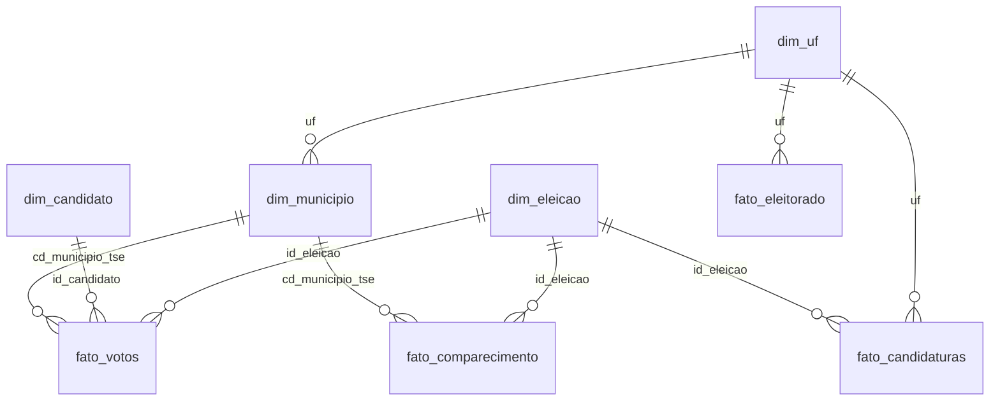

# Painel no Power BI: passo a passo

O site mostra as análises; o Power BI é onde **você** monta um painel com os
mesmos dados. É o que as vagas de dados mais pedem, e numa entrevista você vai
explicar algo que montou.

Tempo estimado: 3 a 5 horas na primeira vez.

## 1. Gerar as tabelas

Depois de rodar o projeto (veja [como_rodar.md](como_rodar.md)):

```bat
.venv\Scripts\python scripts\exportar_powerbi.py
```

As tabelas ficam em `dados\exportar\powerbi\`. Os arquivos têm só números
inteiros e texto: as porcentagens você calcula no Power BI com DAX, o que evita
a confusão entre vírgula e ponto decimal.

## 2. O modelo (esquema estrela)

As tabelas `fato_` guardam os números (votos, eleitores); as `dim_` descrevem
quem, onde e quando. As setas são as relações (muitos → um):



| Tabela | Uma linha por | Colunas principais |
|---|---|---|
| `dim_eleicao` | eleição e turno (2002 a 2026) | `id_eleicao` (ex.: 20261 = 2026, 1º turno), `ano`, `turno`, `data`, `eleicao` |
| `dim_uf` | estado (mais exterior, voto em trânsito de 2010 e "BR" para Presidente) | `uf`, `nome_uf`, `regiao` |
| `dim_municipio` | município (inclusive os que só existiram em eleições antigas) | `cd_municipio_tse`, `cd_municipio_ibge`, `nm_municipio`, `uf`, `regiao`, `capital`, `local_para_mapa` |
| `dim_candidato` | candidato a Presidente em cada eleição | `id_candidato` (ano × 100 + número), `nm_urna`, `sg_partido`, `foi_ao_2o_turno`, `posicao_1o_turno` |
| `fato_votos` | eleição, município e candidato a Presidente | `qt_votos` |
| `fato_comparecimento` | eleição e município | `qt_aptos`, `qt_comparecimento`, `qt_abstencoes`, `qt_brancos`, `qt_nulos`, `qt_validos` |
| `fato_candidaturas` | candidatura (2018, 2022, 2026; todos os cargos) | `ds_cargo`, `sg_partido`, `ds_genero`, `ds_cor_raca`, `idade`, `ds_grau_instrucao`, `situacao`, `eleito`, `vr_patrimonio` |
| `fato_eleitorado` | UF, gênero, faixa etária e escolaridade (2026) | `qt_eleitores` |

## 3. Importar

1. Abra o Power BI Desktop → **Obter dados → Texto/CSV** → escolha
   `dim_eleicao.csv` → **Transformar dados** (não clique em "Carregar" ainda).
2. Repita para cada arquivo (no Power Query: **Nova fonte → Texto/CSV**).
3. No Power Query, confira os tipos de cada coluna (o ícone ao lado do nome):
   - códigos e quantidades (`id_...`, `cd_...`, `qt_...`, `vr_patrimonio`, `idade`): **Número inteiro**;
   - `data`: **Data**;
   - `capital`, `eleito`, `foi_ao_2o_turno`: **Verdadeiro/Falso**;
   - o resto: **Texto**.
4. **Fechar e aplicar.**
5. Na tela **Modelo** (ícone à esquerda), confira as relações do diagrama acima.
   O Power BI costuma criar várias sozinho; apague as que não estiverem na
   lista e crie as que faltarem arrastando a coluna de uma tabela até a outra.
   Todas são **muitos para um**, com filtro em **direção única**.
6. Aplique o tema neutro: **Exibir → Temas → Procurar temas** →
   `powerbi\tema_neutro.json`. As cores não lembram nenhum partido (o mesmo
   critério do site).

## 4. Medidas (DAX)

Crie uma tabela vazia só para as medidas (**Página Inicial → Inserir dados**,
nome `_Medidas`) e, nela, **Nova medida** para cada uma abaixo.

```dax
Votos = SUM ( fato_votos[qt_votos] )

-- votos válidos = soma dos votos de todos os candidatos, ignorando o filtro de candidato
Votos válidos = CALCULATE ( [Votos], REMOVEFILTERS ( dim_candidato ) )

% dos votos válidos = DIVIDE ( [Votos], [Votos válidos] )

Eleitores aptos = SUM ( fato_comparecimento[qt_aptos] )
Comparecimento = SUM ( fato_comparecimento[qt_comparecimento] )
% de comparecimento = DIVIDE ( [Comparecimento], [Eleitores aptos] )
% de abstenção = DIVIDE ( SUM ( fato_comparecimento[qt_abstencoes] ), [Eleitores aptos] )
% de brancos = DIVIDE ( SUM ( fato_comparecimento[qt_brancos] ), [Comparecimento] )
% de nulos = DIVIDE ( SUM ( fato_comparecimento[qt_nulos] ), [Comparecimento] )

-- a mesma medida na eleição de 4 anos antes (mesmo turno)
% de abstenção na eleição anterior =
VAR Ano = SELECTEDVALUE ( dim_eleicao[ano] )
VAR Turno = SELECTEDVALUE ( dim_eleicao[turno] )
RETURN
    CALCULATE (
        [% de abstenção],
        REMOVEFILTERS ( dim_eleicao ),
        dim_eleicao[ano] = Ano - 4,
        dim_eleicao[turno] = Turno
    )

-- diferença em pontos (ex.: 21,1% - 20,9% = 0,2 ponto)
Variação da abstenção (pontos) =
    ( [% de abstenção] - [% de abstenção na eleição anterior] ) * 100

-- candidato com mais votos no filtro atual (ex.: em cada município, num mapa)
Mais votado =
VAR Tabela = ADDCOLUMNS ( VALUES ( dim_candidato[nm_urna] ), "@votos", [Votos] )
RETURN MAXX ( TOPN ( 1, Tabela, [@votos], DESC ), dim_candidato[nm_urna] )

Candidaturas = COUNTROWS ( fato_candidaturas )
Eleitos = CALCULATE ( [Candidaturas], fato_candidaturas[eleito] = TRUE () )
Taxa de eleição = DIVIDE ( [Eleitos], [Candidaturas] )
% de mulheres = DIVIDE ( CALCULATE ( [Candidaturas], fato_candidaturas[ds_genero] = "Feminino" ), [Candidaturas] )
Patrimônio mediano = MEDIAN ( fato_candidaturas[vr_patrimonio] )

Eleitores (perfil) = SUM ( fato_eleitorado[qt_eleitores] )
% do eleitorado = DIVIDE ( [Eleitores (perfil)], CALCULATE ( [Eleitores (perfil)], ALLSELECTED ( fato_eleitorado ) ) )
```

Formate as medidas de `%` como **Porcentagem** com 1 casa decimal (selecione a
medida → **Ferramentas de medida → Formato**).

## 5. Confira antes de montar os gráficos

Faça um cartão com cada medida abaixo, filtrando `dim_eleicao[eleicao]` =
"2026 - 1º turno". Os números têm que bater com o site e com o TSE:

| Medida | Valor esperado |
|---|---|
| `Eleitores aptos` | 158.745.502 |
| `Comparecimento` | 125.275.835 |
| `Votos válidos` | 119.300.788 |
| `Votos` de FLAVIO BOLSONARO | 56.104.503 |
| `Votos` de LULA | 53.879.538 |

Se algum não bater, o problema quase sempre é uma relação faltando ou um tipo
de coluna errado (passo 3).

## 6. Páginas sugeridas

1. **Visão geral de 2026:** cartões (aptos, % de comparecimento, % de
   abstenção), barras com o `% dos votos válidos` por candidato, mapa por UF
   (`dim_uf[nome_uf]` com **Categoria de dados → Estado ou província**) e uma
   segmentação de `dim_eleicao[eleicao]`.
2. **Histórico de 2002 a 2026:** linhas com `% de abstenção`, `% de brancos` e
   `% de nulos` por `dim_eleicao[eleicao]`; matriz de região × eleição.
3. **Municípios:** tabela com busca por nome, `Mais votado` e
   `% de abstenção`; dispersão de `Eleitores aptos` × `% de abstenção`.
4. **Candidatos:** `% de mulheres` por partido (barras) com uma linha
   constante em 30% (a cota); `Taxa de eleição` por gênero e por cor/raça;
   `Patrimônio mediano` por cargo. Segmentações de ano e cargo.
5. **Eleitorado:** pirâmide etária (duas barras horizontais por faixa etária,
   uma por gênero) e escolaridade, com segmentação de UF.

Regras do projeto que valem também no painel: candidatos em ordem alfabética
quando lado a lado, cores do tema neutro, títulos que dizem o que o gráfico
mostra e a fonte (TSE) no rodapé de cada página.

## 7. Guardar no GitHub

- Salve como `powerbi\eleicoes_2026.pbix` (o arquivo fica com os dados dentro;
  se passar de 100 MB, o GitHub não aceita: aí salve como **Projeto do Power BI
  (.pbip)**, que guarda só a estrutura).
- Exporte uma imagem de cada página (**Arquivo → Exportar → PDF**, ou um print)
  para `docs\img\powerbi_*.png` e coloque no README.
- O "Publicar na Web" do Power BI precisa de conta de trabalho ou de escola;
  com conta pessoal, o arquivo e as imagens no GitHub cumprem o papel.
