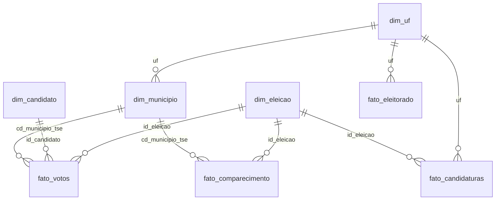

# Painel no Power BI: tutorial completo

O site mostra as análises; o Power BI é onde **você** monta um painel com os mesmos
dados. É a ferramenta que as vagas de dados mais pedem, e numa entrevista você vai
explicar algo que construiu.

**O que você vai construir:** um arquivo `.pbix` com 6 páginas (visão geral de
2026, histórico, municípios, candidatos, dinheiro de campanha e eleitorado), sobre um
modelo em estrela com 8 tabelas.

**Tempo:** de 4 a 6 horas na primeira vez. Dá para fazer em partes: os passos 1 a 6
num dia (dados, modelo e medidas) e as páginas em outro.

**Você não precisa rodar nada em Python:** as tabelas prontas estão em
[`powerbi/dados/`](../powerbi/dados). (Se quiser gerar de novo, veja o fim deste
tutorial.)

---

## Passo 1: instalar e configurar o Power BI Desktop

1. Instale o **Power BI Desktop** (grátis, só para Windows) pela **Microsoft Store**:
   procure "Power BI Desktop". Pela loja, ele se atualiza sozinho.
2. Abra e feche a tela de boas-vindas. Não precisa entrar com conta para usar.
3. **Arquivo → Opções e configurações → Opções**:
   - **Global → Configurações regionais → Localidade para importação:** Português
     (Brasil). Assim as datas e números entram certos.
   - **Global → Segurança → Visuais de mapa e mapa preenchido:** marque **Usar
     visuais de mapa e de mapa preenchido**. Sem isso, os mapas ficam em branco.
4. Feche e abra o Power BI de novo, para as opções valerem.

## Passo 2: baixar as tabelas

No GitHub, abra o repositório → botão verde **Code → Download ZIP**, e descompacte
numa pasta fácil (ex.: `C:\projetos\eleicoes-2026-dados`). As tabelas estão em
`powerbi\dados\`:

| Arquivo | Uma linha por | Linhas (aprox.) |
|---|---|---|
| `dim_eleicao.csv` | eleição e turno (2002 a 2026) | 14 |
| `dim_uf.csv` | UF (mais exterior, voto em trânsito de 2010 e "BR") | 30 |
| `dim_municipio.csv` | município (inclusive os de eleições antigas) | 5.876 |
| `dim_candidato.csv` | candidato a Presidente em cada eleição | 69 |
| `fato_votos.csv` | eleição, município e candidato a Presidente | 456.759 |
| `fato_comparecimento.csv` | eleição e município | 80.036 |
| `fato_candidaturas.csv` | candidatura de 2018, 2022 e 2026 (todos os cargos) | 68.541 |
| `fato_eleitorado.csv` | UF, gênero, faixa etária e escolaridade (2026) | 10.700 |

**Fato e dimensão.** As tabelas `fato_` guardam os **números** (votos, eleitores,
reais). As `dim_` descrevem **quem, onde e quando**. Isso se chama **modelo em
estrela**: as fatos no centro, as dimensões em volta. É o formato que o Power BI
entende melhor, e uma pergunta comum em entrevista.

## Passo 3: importar (Power Query)

Faça para **cada um dos 8 arquivos**:

1. **Página Inicial → Obter dados → Texto/CSV** → escolha o arquivo.
2. Na janela de pré-visualização, confira:
   - **Origem do arquivo:** `65001: Unicode (UTF-8)`. Se os acentos aparecerem
     estranhos ("São"), é aqui que se corrige;
   - **Delimitador:** `Ponto e vírgula`.
3. Clique em **Transformar dados** (não em "Carregar"). Abre o **Power Query**.

No Power Query, para cada tabela (lista à esquerda), confira o **tipo de cada
coluna** (o ícone à esquerda do nome da coluna; clique nele para trocar):

| Colunas | Tipo |
|---|---|
| que começam com `id_`, `cd_`, `qt_`, `vr_`, `nr_`, e `ano`, `turno`, `idade`, `posicao_1o_turno` | **Número inteiro** |
| `data` | **Data** |
| `capital`, `eleito`, `foi_ao_2o_turno` | **Verdadeiro/Falso** |
| todo o resto | **Texto** |

Atenção a duas armadilhas:

- **`cd_municipio_ibge` vazio:** municípios que só existiram em eleições antigas e
  cidades do exterior não têm código IBGE. Fica vazio (`null`), e está certo.
- **Colunas `vr_` e `qt_votos_1t` vazias em 2018 e 2022:** o dinheiro de campanha e
  os votos por candidatura só existem para 2026.

Quando terminar as 8 tabelas: **Página Inicial → Fechar e Aplicar**.

## Passo 4: o modelo (relações)

Clique no ícone **Exibição de modelo** (o terceiro, na barra da esquerda). O Power BI
costuma criar algumas relações sozinho, nem sempre certas. **Apague todas**
(clique na linha → Delete) e crie estas, arrastando a coluna de uma tabela até a
coluna de mesmo nome na outra:

| De (lado "muitos") | Para (lado "um") | Coluna |
|---|---|---|
| `fato_votos` | `dim_eleicao` | `id_eleicao` |
| `fato_votos` | `dim_candidato` | `id_candidato` |
| `fato_votos` | `dim_municipio` | `cd_municipio_tse` |
| `fato_comparecimento` | `dim_eleicao` | `id_eleicao` |
| `fato_comparecimento` | `dim_municipio` | `cd_municipio_tse` |
| `dim_municipio` | `dim_uf` | `uf` |
| `fato_candidaturas` | `dim_eleicao` | `id_eleicao` |
| `fato_candidaturas` | `dim_uf` | `uf` |
| `fato_eleitorado` | `dim_uf` | `uf` |

Em cada relação (clique duas vezes na linha para abrir), confira:
**Cardinalidade: Muitos para um (*:1)** e **Direção do filtro cruzado: Única**.



**Por que "muitos para um" e direção única?** Cada eleição (lado "um") tem muitas
linhas de votos (lado "muitos"). O filtro desce da dimensão para a fato: escolher
"2026 - 2º turno" filtra os votos. Direção única evita filtros andando em círculo,
que dão números errados sem aviso.

Três ajustes que deixam o painel mais fácil:

1. **Ordem das eleições:** na **Exibição de dados**, tabela `dim_eleicao`, selecione a
   coluna `eleicao` → **Ferramentas de coluna → Classificar por coluna →
   `id_eleicao`**. Sem isso, "2002 - 1º turno" e "2002 - 2º turno" ficam fora de
   ordem nos gráficos.
2. **Esconder as chaves:** nas fatos, clique com o botão direito em `id_eleicao`,
   `id_candidato`, `cd_municipio_tse` e `uf` → **Ocultar na exibição de relatório**.
   Assim você sempre filtra pela dimensão (o certo), e não pela fato.
3. **Categoria de dados para o mapa:** em `dim_uf`, coluna `nome_uf` → **Ferramentas
   de coluna → Categoria de dados → Estado ou Província**. Em `dim_municipio`, coluna
   `local_para_mapa` → **Local**.

## Passo 5: o tema neutro

**Exibição → Temas → Procurar temas** → `powerbi\tema_neutro.json`. As cores não
lembram nenhum partido, o mesmo critério do site.

## Passo 6: medidas (DAX)

**Medida** é uma conta que o Power BI refaz para cada pedaço do gráfico. Em vez de
uma coluna "% de votos" fixa, a medida calcula o % certo para o que estiver filtrado:
o Brasil, uma UF, um município.

Crie uma tabela só para guardar as medidas: **Página Inicial → Inserir dados**, nome
`_Medidas`, **Carregar** (o sublinhado põe a tabela no topo da lista). Depois, com
ela selecionada, **Ferramentas de tabela → Nova medida**, cole cada medida abaixo e
aperte Enter.

### Votos e comparecimento

```dax
Votos = SUM ( fato_votos[qt_votos] )
```

Soma os votos do que estiver filtrado. Num gráfico por candidato, dá os votos de
cada um; num cartão sem filtro, o total.

```dax
Votos válidos = CALCULATE ( [Votos], REMOVEFILTERS ( dim_candidato ) )
```

`CALCULATE` refaz uma medida mudando os filtros. Aqui, tira o filtro de candidato:
na linha de LULA, `[Votos]` dá os votos de LULA e `[Votos válidos]` dá os de todos.

```dax
% dos votos válidos = DIVIDE ( [Votos], [Votos válidos] )
```

Use sempre `DIVIDE` em vez de `/`: se o denominador for zero, ele devolve vazio em
vez de erro.

```dax
Eleitores aptos = SUM ( fato_comparecimento[qt_aptos] )
Comparecimento = SUM ( fato_comparecimento[qt_comparecimento] )
% de comparecimento = DIVIDE ( [Comparecimento], [Eleitores aptos] )
% de abstenção = DIVIDE ( SUM ( fato_comparecimento[qt_abstencoes] ), [Eleitores aptos] )
% de brancos = DIVIDE ( SUM ( fato_comparecimento[qt_brancos] ), [Comparecimento] )
% de nulos = DIVIDE ( SUM ( fato_comparecimento[qt_nulos] ), [Comparecimento] )
```

```dax
% de abstenção na eleição anterior =
VAR Ano = SELECTEDVALUE ( dim_eleicao[ano] )
VAR Turno = SELECTEDVALUE ( dim_eleicao[turno] )
RETURN
    CALCULATE (
        [% de abstenção],
        REMOVEFILTERS ( dim_eleicao ),
        dim_eleicao[ano] = Ano - 4,
        dim_eleicao[turno] = Turno
    )
```

`VAR` guarda um valor com nome, para usar depois. `SELECTEDVALUE` pega o ano que está
filtrado (ex.: 2026). O `CALCULATE` tira o filtro de eleição e põe "4 anos antes, mesmo
turno". Resultado: a abstenção de 2022 ao lado da de 2026.

```dax
Variação da abstenção (pontos) =
    ( [% de abstenção] - [% de abstenção na eleição anterior] ) * 100
```

```dax
Mais votado =
VAR Tabela = ADDCOLUMNS ( VALUES ( dim_candidato[nm_urna] ), "@votos", [Votos] )
RETURN MAXX ( TOPN ( 1, Tabela, [@votos], DESC ), dim_candidato[nm_urna] )
```

Monta uma tabelinha "candidato × votos" no filtro atual (ex.: um município) e pega o
primeiro. É assim que se mostra "quem ficou à frente" numa tabela de municípios.

### Candidaturas

```dax
Candidaturas = COUNTROWS ( fato_candidaturas )
Eleitos = CALCULATE ( [Candidaturas], fato_candidaturas[eleito] = TRUE () )
Taxa de eleição = DIVIDE ( [Eleitos], [Candidaturas] )
% de mulheres = DIVIDE ( CALCULATE ( [Candidaturas], fato_candidaturas[ds_genero] = "Feminino" ), [Candidaturas] )
% de pessoas pretas e pardas =
    DIVIDE (
        CALCULATE ( [Candidaturas], fato_candidaturas[ds_cor_raca] IN { "Preta", "Parda" } ),
        [Candidaturas]
    )
Patrimônio mediano = MEDIAN ( fato_candidaturas[vr_patrimonio] )
```

**Por que mediana?** Patrimônio é muito concentrado: poucos milionários puxam a
média para cima. A mediana mostra a candidatura típica.

### Dinheiro de campanha (2026)

```dax
Receitas = SUM ( fato_candidaturas[vr_receitas] )
Fundo eleitoral = SUM ( fato_candidaturas[vr_fundo_eleitoral] )
Fundo partidário = SUM ( fato_candidaturas[vr_fundo_partidario] )
Recursos próprios = SUM ( fato_candidaturas[vr_recursos_proprios] )
Pessoas físicas = SUM ( fato_candidaturas[vr_pessoas_fisicas] )
Despesas = SUM ( fato_candidaturas[vr_despesas] )
% dos fundos públicos = DIVIDE ( [Fundo eleitoral] + [Fundo partidário], [Receitas] )

Votos no 1º turno (candidaturas) = SUM ( fato_candidaturas[qt_votos_1t] )
Custo por voto = DIVIDE ( [Despesas], [Votos no 1º turno (candidaturas)] )

% do fundo para mulheres =
    DIVIDE (
        CALCULATE ( [Fundo eleitoral], fato_candidaturas[ds_genero] = "Feminino" ),
        [Fundo eleitoral]
    )
% do fundo para pessoas pretas e pardas =
    DIVIDE (
        CALCULATE ( [Fundo eleitoral], fato_candidaturas[ds_cor_raca] IN { "Preta", "Parda" } ),
        [Fundo eleitoral]
    )
```

### Eleitorado

```dax
Eleitores (perfil) = SUM ( fato_eleitorado[qt_eleitores] )
% do eleitorado = DIVIDE ( [Eleitores (perfil)], CALCULATE ( [Eleitores (perfil)], ALLSELECTED ( fato_eleitorado ) ) )
```

`ALLSELECTED` usa como total tudo o que está selecionado nas segmentações. Assim, se
você filtrar uma UF, o "% do eleitorado" é dentro daquela UF.

### Formato

Selecione cada medida de `%` → **Ferramentas de medida → Formato: Porcentagem**, 1
casa decimal. As de reais (`Receitas`, `Despesas`...) → **Moeda**, R$, 0 casas. As de
contagem → **Número inteiro** com separador de milhar.

## Passo 7: conferir antes de montar os gráficos

Este é o passo mais importante: **se os números não baterem aqui, nenhum gráfico vai
estar certo.** Numa página de rascunho, crie um **Cartão** para cada medida e uma
**Segmentação de dados** com `dim_eleicao[eleicao]`:

| Eleição | Medida | Valor esperado |
|---|---|---|
| 2026 - 1º turno | `Eleitores aptos` | 158.745.502 |
| 2026 - 1º turno | `Comparecimento` | 125.275.835 |
| 2026 - 1º turno | `Votos válidos` | 119.300.788 |
| 2026 - 1º turno | `Votos` de FLAVIO BOLSONARO | 56.104.503 |
| 2026 - 1º turno | `Votos` de LULA | 53.879.538 |
| 2026 - 2º turno | `Votos válidos` | 124.082.273 |
| 2026 - 2º turno | `Votos` de FLAVIO BOLSONARO | 59.826.041 |
| 2026 - 2º turno | `Votos` de LULA | 64.256.232 |
| 2026 - 2º turno | `Comparecimento` | 128.236.074 |
| (fato_candidaturas, ano 2026) | `Candidaturas` | 18.360 |
| (fato_candidaturas, ano 2026) | `Eleitos` | 1.654 |
| (fato_candidaturas, ano 2026) | `Receitas` | R$ 6.423.656.423 |
| (fato_candidaturas, ano 2026) | `% dos fundos públicos` | 80,9% |

Para os votos de um candidato: um cartão com `[Votos]` e uma segmentação com
`dim_candidato[nm_urna]`.

O total de `Receitas` aqui é um pouco menor que o do site (R$ 6,49 bilhões): o site
soma todas as contas finais, e esta tabela só tem as candidaturas que foram a voto.

**Se algo não bater:** quase sempre é uma relação faltando (passo 4) ou um tipo de
coluna errado (passo 3). Veja também "Problemas comuns", no fim.

## Passo 8: as páginas

Regras do projeto que valem também aqui:

- candidatos em **ordem alfabética** quando aparecem lado a lado;
- cores do **tema neutro**;
- **títulos que dizem o que o gráfico mostra** (ex.: "% dos votos válidos no 2º turno,
  por UF", e não "Gráfico 1");
- a **fonte** (TSE) numa caixa de texto no rodapé de cada página.

Para cada visual: clique no ícone dele no painel **Visualizações**, depois arraste os
campos para os espaços (**Eixo X**, **Eixo Y**, **Valores**, **Legenda**...).

### Página 1: Visão geral de 2026

```
┌──────────────────────────────────────────────────────────────┐
│ Eleições 2026: o 2º turno para Presidente     [segmentação: eleição]
├──────────────┬──────────────┬──────────────┬─────────────────┤
│ cartão:      │ cartão:      │ cartão:      │ cartão:         │
│ votos FLAVIO │ votos LULA   │ % comparec.  │ % abstenção     │
├──────────────┴──────────────┼──────────────┴─────────────────┤
│ barras: % dos votos válidos │ mapa preenchido: % de um        │
│ por candidato               │ candidato por UF                │
├─────────────────────────────┴────────────────────────────────┤
│ Fonte: TSE                                                   │
└──────────────────────────────────────────────────────────────┘
```

1. **Segmentação de dados** com `dim_eleicao[eleicao]`. No painel de formato:
   **Configurações da segmentação → Estilo: Lista suspensa** e **Seleção única:
   ativado**. Escolha "2026 - 2º turno".
2. **Gráfico de barras clusterizado:** Eixo Y = `dim_candidato[nm_urna]`, Eixo X =
   `% dos votos válidos`. Ordene por `nm_urna` em ordem crescente (os três pontinhos do
   visual → **Classificar eixo**): ordem alfabética, e não por votos. Ative os
   **Rótulos de dados**.
3. **Cartões** com `Votos` (dois cartões, cada um com um filtro de visual em
   `dim_candidato[nm_urna]`), `% de comparecimento` e `% de abstenção`.
4. **Mapa preenchido:** Local = `dim_uf[nome_uf]`, Dicas de ferramenta = `% dos votos
   válidos`. Num filtro do visual, escolha **um** candidato em `nm_urna` e, em
   **Cores de preenchimento → fx**, use uma escala de cor pelo `% dos votos válidos`.

### Página 2: Histórico de 2002 a 2026

1. **Gráfico de linhas:** Eixo X = `dim_eleicao[eleicao]`, Eixo Y = `% de abstenção`,
   `% de brancos` e `% de nulos`. Com a classificação do passo 4, as eleições ficam em
   ordem.
2. **Matriz:** Linhas = `dim_uf[regiao]`, Colunas = `dim_eleicao[ano]`, Valores = `% de
   comparecimento`. Em **Formatação condicional → Cor de fundo**, uma escala de uma cor só.
3. **Cartão** com `Variação da abstenção (pontos)`, ao lado de uma segmentação de
   eleição.

### Página 3: Municípios

1. **Segmentação** com `dim_municipio[nm_municipio]`, com **Pesquisa** ativada (três
   pontinhos → **Pesquisar**).
2. **Tabela:** `dim_municipio[nm_municipio]`, `dim_municipio[uf]`, `Mais votado`,
   `% de comparecimento`, `% de abstenção`.
3. **Gráfico de dispersão:** Valores = `dim_municipio[nm_municipio]`, Eixo X =
   `Eleitores aptos`, Eixo Y = `% de abstenção`. Pergunta que ele responde: municípios
   maiores têm mais ou menos abstenção? Use **escala logarítmica** no eixo X
   (formato → Eixo X → Escala: Log), porque São Paulo é 10 mil vezes maior que o
   menor município.

### Página 4: Candidatos

Segmentações: `fato_candidaturas[ano]` e `fato_candidaturas[ds_cargo]`.

1. **Barras:** Eixo Y = `fato_candidaturas[sg_partido]`, Eixo X = `% de mulheres`. Em
   **Analytics** (o ícone de lupa do painel) → **Linha constante** em 0,3 (30%), com o
   rótulo "cota de 30% de candidaturas". Partidos em ordem alfabética.
2. **Barras agrupadas:** Eixo Y = `fato_candidaturas[ds_genero]`, Eixo X = `Taxa de
   eleição`. Faça outra igual com `ds_cor_raca`.
3. **Barras:** Eixo Y = `ds_cargo`, Eixo X = `Patrimônio mediano`, com Legenda =
   `eleito`.

### Página 5: Dinheiro de campanha (2026)

Filtro da página (painel **Filtros → Filtros nesta página**): `fato_candidaturas[ano]`
= 2026.

1. **Cartões:** `Receitas`, `% dos fundos públicos`, `Despesas`.
2. **Matriz** com as fontes do dinheiro: Valores = `Fundo eleitoral`, `Fundo
   partidário`, `Pessoas físicas`, `Recursos próprios`. No formato: **Valores →
   Alternar valores para linhas**. Vira uma tabela "fonte × reais", fácil de ler.
3. **Barras:** Eixo Y = `sg_partido`, Eixo X = `% do fundo para mulheres`, com linha
   constante em 30%. Faça outra com `% do fundo para pessoas pretas e pardas`. Escreva
   no título: "ponto de atenção, não acusação: a conferência oficial é da Justiça
   Eleitoral".
4. **Matriz:** Linhas = `ds_cargo`, Colunas = `eleito`, Valores = `Custo por voto`.

### Página 6: Eleitorado

1. **Pirâmide etária:** gráfico de **barras empilhadas** com Eixo Y =
   `fato_eleitorado[ds_faixa_etaria]`, Eixo X = `Eleitores (perfil)`, Legenda =
   `fato_eleitorado[ds_genero]`. (Uma pirâmide de verdade, com um
   lado para cada gênero, pede uma medida negativa para um deles: um bom desafio extra.)
2. **Barras:** Eixo Y = `fato_eleitorado[ds_grau_instrucao]`, Eixo X = `% do eleitorado`.
3. **Segmentação** com `dim_uf[nome_uf]`.

## Passo 9: guardar e mostrar

1. **Salvar:** **Arquivo → Salvar como** → `powerbi\eleicoes_2026.pbix`. Se o arquivo
   passar de 100 MB (o GitHub não aceita), salve como **Projeto do Power BI
   (.pbip)**, que guarda a estrutura em arquivos de texto.
2. **Imagens:** **Arquivo → Exportar → Exportar para PDF** gera uma página por aba. Ou
   tire um print de cada página e salve em `docs\img\powerbi_1.png`, `powerbi_2.png`...
3. **README:** me mande as imagens (ou o PDF) e eu ponho uma seção "Painel no Power
   BI" no README, com as imagens e o que cada página mostra.
4. **LinkedIn:** um post com 2 ou 3 imagens do painel e o link do site e do GitHub.
   Escreva o que você aprendeu, não só o que fez.

"Publicar na Web" precisa de conta de trabalho ou de escola; com conta pessoal, o
arquivo e as imagens no GitHub cumprem o papel.

## Problemas comuns

| O que acontece | Causa provável | O que fazer |
|---|---|---|
| Os números não batem com o passo 7 | relação faltando ou com a coluna errada | passo 4: confira cada relação |
| Todas as linhas de um gráfico têm o mesmo número | o campo do eixo vem de uma tabela sem relação com a fato | use o campo da dimensão ligada à fato (ex.: `dim_candidato[nm_urna]`, não a coluna da fato) |
| Acentos estranhos ("São Paulo") | arquivo importado com a codificação errada | Power Query → clique na engrenagem do passo "Fonte" → Origem do arquivo: 65001 (UTF-8) |
| Mapa em branco | visuais de mapa desligados | passo 1, item 3 |
| Mapa põe uma cidade no país errado | nome de cidade ambíguo | use `dim_municipio[local_para_mapa]` ("Cidade, UF, Brasil") |
| "% dos votos válidos" passa de 100% ou dá 100% em todo lugar | `Votos válidos` sem o `REMOVEFILTERS` | confira a medida do passo 6 |
| Erro "não é possível criar relação: valores duplicados" | relação feita ao contrário | o lado "um" é sempre a `dim_` |
| Eleições fora de ordem | falta a classificação | passo 4, ajuste 1 |

## No que eu posso te ajudar

Eu não consigo abrir o Power BI Desktop (é um programa de Windows), mas posso:

- **Gerar e atualizar as tabelas:** por exemplo, depois de 24/11, com as contas de
  campanha do 2º turno; ou acrescentar uma tabela nova que você queira (ex.: o 2º
  turno por seção do DF).
- **Escrever e corrigir medidas DAX:** me diga o que quer calcular ("% de votos de cada
  candidato no Nordeste em 2022 e 2026, lado a lado") ou me mande a mensagem de erro, e
  eu devolvo a medida explicada.
- **Conferir os números:** me mande um print de um cartão ou tabela e eu confiro com
  os dados do projeto.
- **Revisar o visual:** me mande prints das páginas e eu aponto o que melhorar (títulos,
  cores, ordem, rótulos), com o mesmo critério do site.
- **Ensaiar a apresentação:** você me explica o painel como se fosse a entrevista e eu
  faço as perguntas que um recrutador faria.
- **Pôr o painel no README e no site:** com as imagens que você mandar.

## Para gerar as tabelas de novo (opcional)

Só se quiser atualizar os dados você mesmo. Depois de rodar o projeto
(veja [como_rodar.md](como_rodar.md)):

```bat
.venv\Scripts\python scripts\site_candidatos.py
.venv\Scripts\python scripts\site_eleitorado.py
.venv\Scripts\python scripts\site_dinheiro.py
.venv\Scripts\python scripts\exportar_powerbi.py
```

As tabelas saem em `dados\exportar\powerbi\`. Os arquivos têm só números inteiros e
texto: as porcentagens são calculadas no Power BI, com DAX, o que evita a confusão
entre vírgula e ponto decimal.
