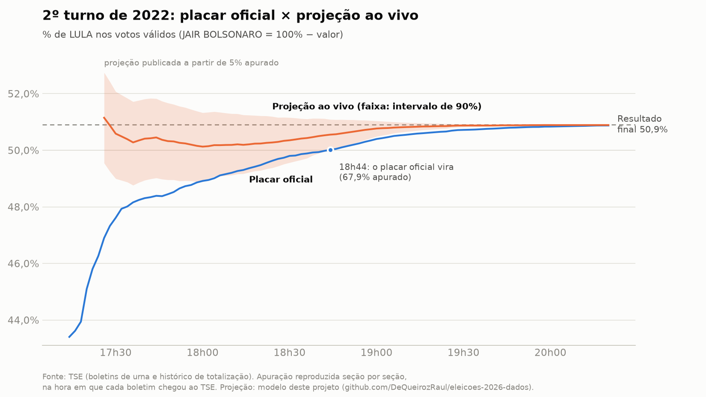
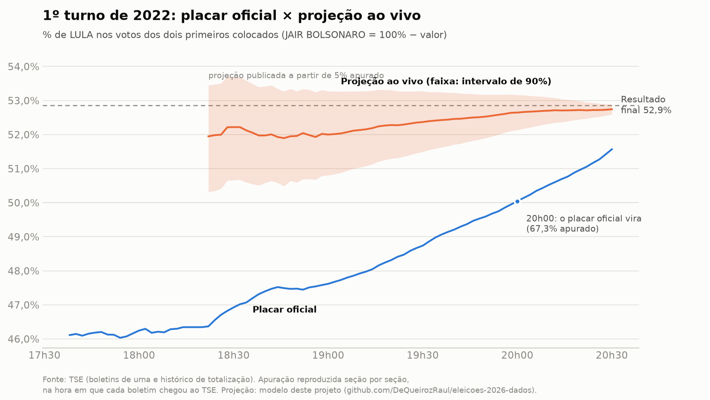
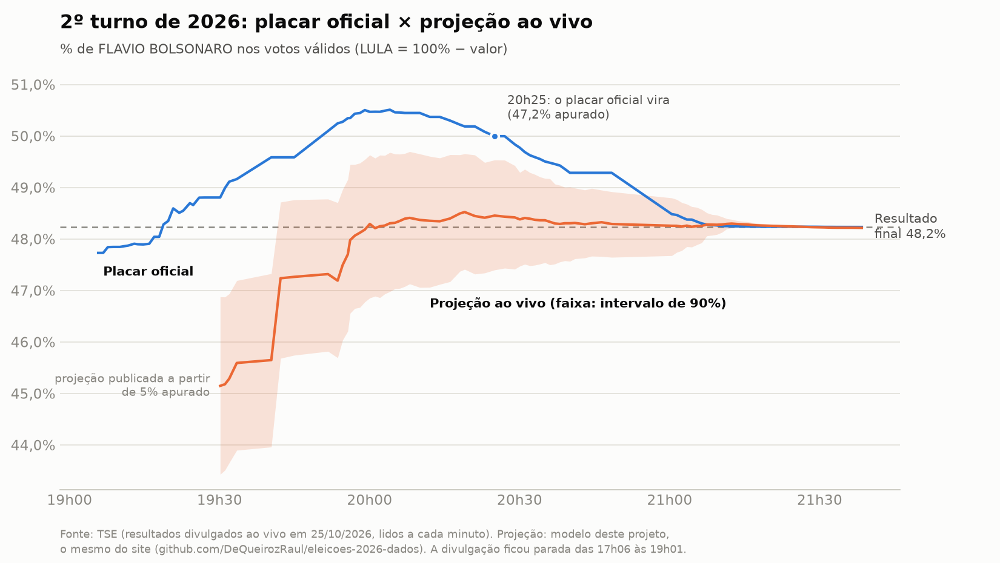

# Metodologia da previsão do 2º turno

A previsão tem duas partes: uma **antes da eleição** (com base no 1º turno) e
uma **ao vivo** (atualizada durante a apuração). As duas usam só resultados
oficiais do TSE. O modelo não entrevista eleitores e, portanto, não é pesquisa
eleitoral. O resultado é sempre apresentado como probabilidade com margem de
incerteza.

Os candidatos aparecem com o nome real. Dentro do modelo, "A" é o 1º colocado
no total nacional do 1º turno e "B" o 2º; as mesmas regras valem para os dois e
nada no modelo depende de partido.

## Parte 1: antes do 2º turno

Código: [`eleicoes/modelo_2t.py`](../eleicoes/modelo_2t.py) e
[`scripts/prever_2t.py`](../scripts/prever_2t.py).
Dados: votação para Presidente por município em todos os 2º turnos desde 2002
(2002, 2006, 2010, 2014, 2018 e 2022) e o 1º turno de 2026.

**Pergunta:** sabendo como cada município votou no 1º turno, qual será a
porcentagem de cada finalista no 2º turno?

### Etapa nacional: quanto o placar muda entre os turnos

A maior parte da mudança vem dos votos dos candidatos eliminados. Um padrão
aparece nas eleições passadas: **em 5 das 6, o 1º colocado do 1º turno ficou com
menos da metade dos votos que eram dos eliminados**.

| Ano | 1º colocado no 1º turno | Votos nos eliminados | Parte que foi para o 1º colocado* |
|---|---|---|---|
| 2002 | LULA | 30,4% | 49% |
| 2006 | LULA | 9,8% | 125% |
| 2010 | DILMA | 20,5% | 45% |
| 2014 | DILMA | 24,9% | 40% |
| 2018 | JAIR BOLSONARO | 24,7% | 37% |
| 2022 | LULA | 8,4% | 30% |

\* Conta simplificada: quanto o 1º colocado cresceu entre os turnos, dividido
pelos votos dos eliminados. Passar de 100% (2006) significa que o 2º colocado
também perdeu votos de um turno para o outro.

O modelo transforma isso em: a mudança do placar entre os finalistas (na escala
logit) é proporcional à fatia dos eliminados, mais um choque que não depende
dela:

```
delta = k × (fatia dos eliminados) + choque
```

`k` e o tamanho típico do choque são estimados com as eleições anteriores.
2006 é o que deixa o choque grande.

### Etapa municipal: como essa mudança se distribui pelo país

```
logit(% de A no 2º turno no município) =
      logit(% de A entre os dois finalistas no 1º turno)
    + delta                                         mudança nacional
    + λ × delta × (eliminados no município / eliminados no país − 1)
    + γ × eliminados no município × (logit local − logit nacional)
    + efeito da UF + ruído do município
```

- **λ = 0,30:** a mudança é maior onde os eliminados tiveram mais votos (30%
  proporcional, 70% igual em todo lugar).
- **γ = −0,69:** os eleitores dos eliminados acompanham o voto do município,
  mas de forma mais equilibrada; onde um finalista domina, a vantagem dele
  diminui um pouco no 2º turno.
- O ruído do município é maior em municípios pequenos.

Comparamos seis versões dessa etapa (de "mudança igual em todo o país" até a
versão com todos os termos) prevendo cada eleição com as outras cinco. A
escolhida teve o menor erro médio por município:

| Versão | Erro médio por município (pontos) |
|---|---|
| Mudança igual em todo o país | 3,59 |
| + regressão à média | 3,36 |
| + mais mudança onde há mais eliminados (λ) | 3,84 |
| λ + regressão à média | 3,48 |
| **λ + γ (escolhida)** | **3,12** |
| λ + γ + regressão à média | 3,22 |

### Incerteza

Simulação de Monte Carlo (20 mil cenários) com três camadas de erro, todas
calibradas pelas eleições anteriores:

- **nacional:** todos os municípios erram juntos para o mesmo lado (é a maior
  fonte de incerteza);
- **por UF;**
- **por município.**

### Validação: cada eleição prevista com o modelo treinado nas outras

| Ano | A (1º no 1º turno) | B | Resultado de A | Previsto | Intervalo 90% | Chance de A | Erro nacional | Erro por município |
|---|---|---|---|---|---|---|---|---|
| 2002 | LULA | JOSÉ SERRA | 61,3% | 63,6% | 52,7% a 73,1% | 97% | +2,3 | 5,1 |
| 2006 | LULA | GERALDO ALCKMIN | 60,8% | 52,2% | 49,7% a 54,7% | 93% | −8,7 | 3,5 |
| 2010 | DILMA | JOSÉ SERRA | 56,1% | 56,1% | 46,2% a 65,4% | 87% | 0,0 | 2,0 |
| 2014 | DILMA | AÉCIO NEVES | 51,6% | 52,0% | 42,3% a 61,6% | 64% | +0,3 | 3,3 |
| 2018 | JAIR BOLSONARO | FERNANDO HADDAD | 55,1% | 58,9% | 49,9% a 67,1% | 95% | +3,7 | 4,0 |
| 2022 | LULA | JAIR BOLSONARO | 50,9% | 51,6% | 42,6% a 60,7% | 64% | +0,7 | 0,8 |

- O resultado real ficou dentro do intervalo de 90% em 5 das 6 eleições. A
  exceção é 2006: treinado só nas outras cinco, o modelo não conhecia um 2º
  turno em que um finalista perde votos.
- O vencedor teve mais de 50% de chance em todas, mas isso diz pouco: em todas
  elas o 1º colocado do 1º turno venceu o 2º.
- Os intervalos são largos (cerca de ±9 pontos). Com só seis eleições, uma delas
  atípica, isso é o que os dados permitem afirmar.

### Previsão para 2026

Candidatos em ordem alfabética:

| Candidato | 1º turno (válidos) | Previsto no 2º turno | Intervalo 90% | Chance de vencer |
|---|---|---|---|---|
| FLAVIO BOLSONARO | 47,0% | 50,0% | 42,3% a 57,4% | 50% |
| LULA | 45,2% | 50,0% | 42,6% a 57,7% | 50% |

**Leitura:** só com o 1º turno, o 2º está empatado. A vantagem de 1,9 ponto do
1º colocado é compensada pelo padrão histórico de o 1º colocado receber menos
da metade dos votos dos eliminados (7,8% em 2026). A margem de erro é grande
porque a história inclui uma virada atípica (2006).

**Sensibilidade a escolhas do modelo** (chance de FLAVIO BOLSONARO; a de LULA é
o complemento):

| Escolha | Previsto | Intervalo 90% | Chance |
|---|---|---|---|
| Modelo principal | 50,0% | 42,3% a 57,4% | 50% |
| Sem 2006 no treino | 49,7% | 47,3% a 52,1% | 42% |
| Mudança igual em todos os municípios | 50,1% | 42,4% a 57,6% | 51% |

Tirar 2006 deixa o intervalo bem mais estreito, mas não há motivo objetivo para
descartar uma eleição real, então o modelo principal usa todas.

A previsão por UF e por município fica em `dados/modelo/` (gerada pelo script).

### Como ficou

Resultado do TSE: FLAVIO BOLSONARO 48,23% e LULA 51,77% dos votos válidos.

| Escolha | Previsto (FLAVIO BOLSONARO) | Intervalo 90% | Erro | Resultado dentro do intervalo? |
|---|---|---|---|---|
| Modelo principal | 50,0% | 42,3% a 57,4% | +1,7 | sim |
| Sem 2006 no treino | 49,7% | 47,3% a 52,1% | +1,5 | sim |
| Mudança igual em todos os municípios | 50,1% | 42,4% a 57,6% | +1,9 | sim |
| Cenários de transferência dos eliminados | 51,0% a 51,5% | — | +2,8 a +3,3 | não |

O erro do modelo principal (1,7 ponto) ficou perto do erro típico da validação
(metade das eleições com até 1,5 ponto), e o resultado ficou dentro do
intervalo. A chance era de 50% para cada lado: só com o 1º turno, o modelo não
apontava quem venceria, e quem venceu foi o 2º colocado do 1º turno. Os cenários
de transferência erraram mais, como a validação já indicava (seção abaixo): o
2º turno não foi decidido pelos eleitores dos eliminados.

### Limitações

- Não usa pesquisas, então não capta o que a campanha muda entre os turnos.
  Pesquisas podem entrar numa versão futura, se melhorarem a validação.
- Pondera os municípios pelos votos válidos do 1º turno; mudanças de
  comparecimento no 2º turno não são modeladas.
- Seis eleições é pouco: os parâmetros nacionais têm muita incerteza, e ela
  está refletida nos intervalos.

## Cenários: para onde vão os eleitores dos eliminados

Código: [`eleicoes/transferencia.py`](../eleicoes/transferencia.py) e
[`scripts/cenarios_transferencia.py`](../scripts/cenarios_transferencia.py).

### De onde vieram

Não existe o voto de cada pessoa, só os totais por município. Mas, cruzando os
5.570 municípios, dá para estimar que parte dos eleitores de cada candidato de
2026 votou em cada lado no 2º turno de 2022 (inferência ecológica, estimada por
região). Os eleitores dos eliminados em 2026 vieram de:

| Candidato eliminado | Votou JAIR BOLSONARO em 2022 | Votou LULA em 2022 | Não votou válido em 2022 |
|---|---|---|---|
| ESCRITOR AUGUSTO CURY | 51% | 45% | 4% |
| RENAN SANTOS | 50% | 29% | 21% |
| RONALDO CAIADO | 32% | 44% | 24% |
| Demais | 27% | 45% | 28% |
| **Total dos eliminados** | **44%** | **40%** | **16%** |

A estimativa de cada candidato muda bastante conforme se agrupam os municípios
(estimando para o Brasil todo ou por UF, a origem "JAIR BOLSONARO" dos eleitores
de RONALDO CAIADO vai de 32% a 62%), então ela não deve ser lida isoladamente.
O total dos eliminados é estável: 44% a 47% do lado JAIR BOLSONARO, 31% a 40% do
lado LULA e 16% a 22% sem lado, nas três formas de agrupar.

### Cenários

"Fidelidade" é a parte dos eleitores dos eliminados que vota no finalista do
lado em que votou em 2022 (FLAVIO BOLSONARO para quem votou em JAIR BOLSONARO;
LULA para quem votou em LULA). "Troca" é a parte que vota no outro finalista. O
resto vota branco, nulo ou não vai. Nunca 100% vai para um lado só.

% de FLAVIO BOLSONARO nos votos válidos (LULA = 100% menos o valor):

| Fidelidade | Troca 5% | Troca 10% | Troca 20% | Troca 30% |
|---|---|---|---|---|
| 50% | 51,04% | 51,03% | 51,01% | 50,99% |
| 60% | 51,05% | 51,04% | 51,02% | 51,00% |
| 70% | 51,06% | 51,05% | 51,03% | 51,01% |
| 80% | 51,07% | 51,06% | 51,04% | |
| 90% | 51,08% | 51,07% | | |

Considerando também as outras formas de agrupar os municípios, todos os
cenários ficam entre **51,0% e 51,5%** para FLAVIO BOLSONARO (48,5% a 49,0% para
LULA), praticamente o placar do 1º turno entre os dois (51,0% × 49,0%).

**Leitura:** como os eleitores dos eliminados vieram em proporções parecidas
dos dois lados de 2022, a transferência deles quase não mexe no placar. O 2º
turno de 2026 deve ser decidido menos pelos eliminados e mais por quem volta
ou deixa de ir votar e por quem troca de finalista. O modelo principal capta
isso só pelo padrão histórico das mudanças entre turnos, e é daí que vem a
diferença entre os ~51% dos cenários e os 50% do modelo.

Para comparar: em 2022 os eleitores dos eliminados vinham principalmente do
lado JAIR BOLSONARO de 2018 (6,8 milhões, contra 1,4 milhão do lado do PT), e
os cenários iam de 50,7% a 52,2% para LULA. O resultado real (50,9%) ficou no
cenário de fidelidade alta.

### Por que isso não virou a previsão principal

Testamos o método como previsão: ajustamos os parâmetros (fidelidade, troca,
quem não tinha lado, volta de quem não votou no 1º turno e desistência dos
eleitores dos finalistas) em cada eleição de 2006 a 2022 e previmos cada uma
com a média das outras.

| Ano | Real | Previsto com as outras eleições | Erro | Ajustado na própria eleição |
|---|---|---|---|---|
| 2006 | 60,8% | 54,9% | −5,9 | 58,0% |
| 2010 | 56,1% | 60,6% | +4,5 | 57,1% |
| 2014 | 51,7% | 55,0% | +3,4 | 54,3% |
| 2018 | 55,1% | 57,6% | +2,5 | 56,4% |
| 2022 | 50,9% | 51,6% | +0,7 | 51,2% |

O erro médio (3,4 pontos) foi maior que o do modelo principal nas mesmas
eleições (2,7). Nem ajustado na própria eleição o método reproduz bem 2010 e
2014. Por isso ele fica como ferramenta de cenários, não como previsão.

### O que pode dar mais precisão

- **Apuração ao vivo (Parte 2):** é onde a incerteza cai de verdade, porque o
  modelo passa a ver votos reais do 2º turno.
- **Pesquisas:** são a única fonte, antes da eleição, sobre quem troca de lado
  ou deixa de votar. Podem entrar numa versão futura, se melhorarem a validação.

## Parte 2: ao vivo, durante a apuração

O placar parcial engana porque as urnas não chegam em ordem aleatória: cada
região apura num ritmo diferente. No 2º turno de 2022 (histórico oficial de
totalização do TSE):

- com 50% das seções apuradas (18h27), LULA tinha 49,7% dos votos válidos e
  JAIR BOLSONARO, 50,3%;
- a liderança no placar só mudou às 18h44, com 68% das seções apuradas;
- o resultado final foi LULA 50,9% e JAIR BOLSONARO 49,1%.

A previsão ao vivo corrige isso olhando para o que já chegou **e** para o que
ainda falta chegar:

1. **Coleta:** a cada minuto, o `scripts/coletar_ao_vivo.py` baixa o andamento de
   todas as UFs e o resultado dos municípios que mudaram.
2. **Votos que faltam:** para cada município, eleitores das seções ainda não
   apuradas × comparecimento esperado.
3. **Como esses votos devem se dividir:** começa pela previsão da Parte 1 para o
   município e vai se aproximando do resultado parcial do próprio município à
   medida que ele é apurado (com cautela, porque dentro de uma cidade as
   seções também não chegam em ordem aleatória).
4. **Aprender com o próprio erro:** quando um município termina, comparamos o
   resultado real com a previsão. Se o modelo está errando 1 ponto para o
   mesmo lado nos municípios já apurados de uma UF, provavelmente erra também
   nos que faltam; esse desvio (nacional e por UF) é aplicado ao que falta
   apurar. É isso que faz a previsão convergir rápido, e é aqui que a incerteza
   grande da Parte 1 deve encolher nos primeiros minutos da apuração.
5. **Simulação:** milhares de cenários para o que falta apurar, gerando a
   porcentagem final projetada com intervalo e a probabilidade de cada
   finalista, atualizadas a cada minuto.

### Teste reproduzindo as apurações de 2022

Código: [`eleicoes/ao_vivo.py`](../eleicoes/ao_vivo.py) e
[`scripts/testar_ao_vivo_2022.py`](../scripts/testar_ao_vivo_2022.py).

Os boletins de urna de 2022 trazem, para cada seção, os votos e a hora em que
o boletim chegou ao TSE (`DT_BU_RECEBIDO`). Reproduzindo a apuração nessa
ordem, a curva bate com o histórico oficial de totalização do 2º turno:
diferença média de 0,4 ponto no % de seções apuradas e de 0,07 ponto no % de
LULA. Então dá para rodar a previsão ao vivo "como se fosse aquela noite", a
cada 2 minutos, nos dois turnos.

**2º turno de 2022.** A previsão de antes da eleição vem do modelo da Parte 1
treinado só com 2002 a 2018, sem saber nada de 2022 além do 1º turno.



**1º turno de 2022.** Aqui o alvo é o placar entre LULA e JAIR BOLSONARO. A
previsão de antes é só o mapa do 2º turno de 2018 (lado do PT × outro lado),
com incerteza nacional grande, porque esse mapa não diz nada sobre o nível de
2022. É um teste mais difícil: o modelo tem de aprender quase tudo durante a
noite.



Erro em relação ao resultado final (pontos percentuais):

| Apurado | 2º turno: placar oficial | 2º turno: projeção | 1º turno: placar oficial | 1º turno: projeção |
|---|---|---|---|---|
| 5% | −4,6 | +0,5 | −6,5 | −0,7 |
| 10% | −2,9 | −0,5 | −5,8 | −0,7 |
| 25% | −2,1 | −0,7 | −5,2 | −0,8 |
| 50% | −1,2 | −0,6 | −3,8 | −0,4 |
| 75% | −0,7 | −0,2 | −2,3 | −0,2 |

- **Lado certo desde o início:** depois de 5% apurado, a projeção mostrou LULA à
  frente o tempo todo nos dois turnos. O placar oficial só virou às 18h44 no
  2º turno (68% apurado) e às 20h00 no 1º (67%).
- **Intervalo honesto:** o resultado final ficou dentro do intervalo de 90% em
  98% dos momentos entre 5% e 99,5% apurado no 2º turno e em 100% no 1º.
  Contando também o fim da noite (acima de 99,5%), 92% no 2º turno: nos
  últimos minutos a margem fica mais estreita que os milésimos de ponto que o
  resultado ainda muda. A largura média do intervalo
  foi de ~3 pontos com 5–10% apurado, ~2 pontos com 25–50% e ~1,2 ponto com
  50–75%.
- **Chance acima de 90%:** de forma estável, a partir de 18h40 no 2º turno (64%
  apurado), uma disputa decidida por 1,8 ponto, e desde a primeira publicação
  (5,5% apurado) no 1º turno, decidido por 5,7 pontos.
- **Sobra um viés pequeno:** a projeção ficou de 0,5 a 0,8 ponto abaixo do final
  durante boa parte das duas noites. As seções que chegam primeiro votaram um
  pouco mais em JAIR BOLSONARO do que as últimas, mesmo descontados UF e
  tamanho. O intervalo cobre isso.

### O que mudou no modelo por causa desses testes

1. **O que falta apurar pode ser diferente do que já chegou.** A primeira
   versão supunha que não, e no 2º turno o intervalo continha o final em só 8%
   dos momentos. Entrou um desvio comum aos votos que faltam (0,04 no país e
   0,05 por UF, na escala logit), com tamanho escolhido pela diferença entre a
   primeira e a segunda metade das seções nas capitais.
2. **Só publicar a partir de 5% apurado.** Antes disso os primeiros boletins vêm
   de poucas regiões e a projeção oscila (chegou a 54% com 1% apurado no 2º
   turno).
3. **O erro pode depender do tamanho do município.** Com os ajustes 1 e 2, o
   teste no 1º turno ainda falhou: viés de 2 pontos por horas e intervalo
   contendo o final em só 5% dos momentos. A causa: em relação ao mapa de 2018,
   LULA foi muito melhor nas cidades grandes do que nas pequenas (diferença de
   cerca de 0,3 na escala logit), e as pequenas apuram primeiro. Entrou uma
   inclinação por log(eleitores), com faixa larga a priori (0,2), que o modelo
   aprende durante a noite. No 2º turno ela quase não mudou nada.

**Ressalva:** o ajuste 3 foi feito depois de ver o resultado do 1º turno. Então
os dois testes de 2022 já ajudaram a desenhar o modelo, e o teste realmente
independente foi a noite de 25/10/2026 (abaixo). Os parâmetros não foram ajustados
para acertar nenhum dos dois testes: o 1 e o 3 vieram dos diagnósticos e o 2 é
uma regra simples.

## A noite de 25/10/2026

Resultado do TSE: **FLAVIO BOLSONARO 48,23%** e **LULA 51,77%** dos votos
válidos. A projeção foi gravada a cada minuto pelo
[`scripts/gravar_noite.py`](../scripts/gravar_noite.py), que roda o mesmo código
do site, e comparada com o resultado pelo
[`scripts/analisar_noite.py`](../scripts/analisar_noite.py).

**Uma noite fora do roteiro.** A votação foi prorrogada até as 19h em todo o
país por decisão do STF (ministro Cristiano Zanin). O TSE parou a divulgação às
17h06, com 0,25% das seções apuradas, e só voltou às 19h01. A gravação começou
às 17h08: nada se perdeu, porque o TSE não publicou nada novo entre 17h06 e
19h01.



Erro em relação ao resultado final, no momento em que o TSE chegou a cada % de
seções apuradas (pontos percentuais, no % de FLAVIO BOLSONARO):

| Apurado (TSE) | Horário | Placar oficial | Projeção | O que a projeção já tinha lido |
|---|---|---|---|---|
| 5% | 19h31 | +0,8 | −3,1 | 5% do eleitorado |
| 10% | 19h40 | +1,4 | −2,6 | 7% |
| 25% | 20h04 | +2,3 | +0,1 | 23% |
| 50% | 20h29 | +1,6 | +0,2 | 42% |
| 75% | 21h00 | +0,3 | 0,0 | 68% |

- **Começou mal.** Nas cinco primeiras atualizações publicadas (19h30 a 19h40,
  com 5% a 7% do eleitorado lido), a projeção ficou de 2,6 a 3,1 pontos abaixo
  do resultado final de FLAVIO BOLSONARO, e o resultado ficou fora da margem de
  90%. Nesse começo, o placar oficial estava mais perto do final (0,8 a 1,4
  ponto) do que a projeção. A chance mostrada para quem venceu já passava de 99%:
  o lado estava certo, mas a margem era estreita demais para o erro que havia.
- **Depois, convergiu.** A partir de 19h54 o erro ficou sempre abaixo de 1
  ponto e, a partir de 20h, abaixo de 0,3.
- **Lado do vencedor:** a projeção ficou do lado de quem venceu em todas as
  atualizações. O placar oficial mostrou o outro candidato à frente até 20h25
  (47% apurado).
- **Margem:** o resultado final ficou dentro da margem de 90% em 92% das
  atualizações entre 5% e 99,5% apurado. As que ficaram de fora foram as cinco
  do começo. Contando o fim da noite, 83%: lá a margem fica mais estreita que os
  milésimos de ponto que o resultado ainda mudou. Largura média da margem: 3,4
  pontos com 5% a 10% lido, 2,8 com 10% a 25%, 2,2 com 25% a 50% e 1,4 com 50% a
  75%.

### O que deu errado na coleta

1. **O TSE limitou os pedidos.** Entre 19h30 e 19h53, e de novo depois das
   20h40, o servidor de resultados (Akamai) respondeu "pedidos demais" (HTTP
   429) a parte dos arquivos. A projeção ficou atrás do TSE: às 19h40 o TSE já
   tinha 10,9% das seções apuradas e ela, 6,9% do eleitorado. Em 17 das 118
   rodadas o arquivo do Brasil não veio; o gráfico repete o último placar
   recebido. Desde 19h53 o gravador pede menos: dois arquivos de cada vez, sem
   repetir o pedido na hora, e no máximo 150 a 400 municípios por rodada,
   começando pelos que mais avançaram.
2. **Arquivo de município mais velho que o andamento.** O cache do TSE às vezes
   entregava o arquivo de votos de um município ainda sem as seções que o
   andamento da UF já dava como apuradas. O código contava essas seções como
   apuradas sem nenhum voto e só baixava o município de novo na mudança
   seguinte. Às 19h53, 331 municípios estavam assim. Na projeção, esses
   municípios saíam da conta: os votos apurados (zero) e, a partir de 20%
   apurado, também os que faltavam. Corrigido no gravador às 19h55: o arquivo
   só conta se tiver pelo menos as seções do andamento. O site no ar naquela
   noite ainda tinha o erro, corrigido depois.

**O que não dá para saber só com a gravação:** quanto do erro do começo veio do
modelo e quanto veio da coleta (municípios a menos e municípios zerados). O
teste limpo é o mesmo feito com 2022: quando o TSE publicar os boletins de urna
do 2º turno de 2026, com a hora de chegada de cada um, dá para reproduzir a
noite seção por seção, sem os problemas de coleta.

### Governador

Placar oficial nas seis UFs com 2º turno (votos válidos, candidatos em ordem
alfabética), na última leitura da noite:

| UF | Candidatos |
|---|---|
| AC | ALAN RICK 33,79% · MAILZA ASSIS 66,21% |
| AM | OMAR AZIZ 61,42% · PROFESSORA MARIA DO CARMO 38,58% (99,94% das seções) |
| DF | CELINA LEÃO 57,18% · LEANDRO GRASS 42,82% |
| ES | LORENZO PAZOLINI 52,17% · RICARDO FERRAÇO 47,83% |
| RN | ALLYSON 49,23% · CADU DE LULA 50,77% |
| TO | PROFESSORA DORINHA 35,48% · VICENTINHO JÚNIOR 64,52% |

## Como gravar e analisar uma noite

```bash
# durante a apuração: uma linha por minuto em dados/ao_vivo/
python scripts/gravar_noite.py --ate 2026-10-25T23:00:00-03:00
# depois: arquivos do site, gráfico e números desta página
python scripts/analisar_noite.py
```

Se o processo cair, rodar de novo continua de onde parou (o estado dos
municípios é salvo a cada rodada).

A gravação bruta de 25/10/2026 (`dados/ao_vivo/noite_e6258.csv` e
`noite_governador_e6260.csv`) está no repositório, como exceção à pasta
`dados/`, porque uma noite de apuração não se repete.
